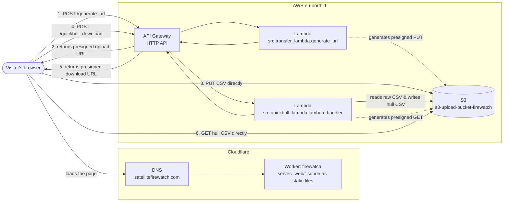

# ECM3428 Group Project Submission

|                        |                                                                                                                                          |
| ---------------------- | ---------------------------------------------------------------------------------------------------------------------------------------- |
| **Project title**      | Satellite Fire Watch                                                                                                                     |
| **Selected algorithm** | Quickhull                                                                                                                                |
| **Problem statement**  | Given a set of raw coordinate data from fire monitoring satellites, identify the convex hull (which represents the surface area at risk) |
| **Intended users**     | Fire departments in affected areas, wildfire researchers                                                                                 |

## URL

The website is live at [satellitefirewatch.com](https://satellitefirewatch.com).

## Install

- The website is hosted on AWS, using S3 for file storage and Lambdas for
  serverless compute.
- For running locally, the only requirement is a Python runtime (3.12+).
- Try it out locally using:

  ```sh
  python3 -m venv venv
  source venv/bin/activate # (or ./venv/Scripts/Activate.ps1 on Windows)
  pip install -r requirements.txt
  python3 -m http.server
  ```

  And then visit <http://localhost:8000>.



## Testing

Install the development dependencies, then run our Python test suite using

```sh
pip install -r requirements-dev.txt
python3 -m unittest
```

We have a mix of white-box and black-box testing.

## Pseudocode


## Time and space complexity

| **Time complexity** |                  |
| ------------------- | ---------------: |
| Average             | $O(n \: log(n))$ |
| Worst case          |         $O(n^2)$ |

On average, the time complexity of the Quickhull algorithm is $O(n \: log(n))$,
with $n$ being the number of points. However, certain configurations of inputs
can lead to a worst case time complexity of $O(n^2)$, due to recursion (in the
divide and conquer strategy) not creating an efficient partitioning of work
(unbalanced partitions cause every "division" to be a partitioning of the work
into two **unequal** parts).

| **Space complexity** |        |
| -------------------- | -----: |
| All cases            | $O(n)$ |

In all input configurations, the space complexity of the Quickhull algorithm is
$O(n)$.

## Dependencies and third-party resources

|                           |                                                                                                                                                                                                                                                                                                                                                                                                                      |
| ------------------------- | -------------------------------------------------------------------------------------------------------------------------------------------------------------------------------------------------------------------------------------------------------------------------------------------------------------------------------------------------------------------------------------------------------------------- |
| **Third-party resources** | The initial datasets for historic fire locations were taken from NASA's FIRMS (Fire Information for Resource Management System) dataset, freely available [here](https://firms.modaps.eosdis.nasa.gov/active_fire). <br>Settlement data is gathered from the Natural Earth Populated Places dataset, freely available [here](https://www.naturalearthdata.com/downloads/10m-cultural-vectors/10m-populated-places/). |
| **Dependencies**          | Python 3.12+ for runtime. <br>Amazon AWS S3 and Lambdas for file storage and compute (and AWS SDK for deployment). <br>Cloudflare for DNS and edge hosting.                                                                                                                                                                                                                                                          |

## Limitations

TODO

## Individual Contributions

- **Emre Acarsoy**:
  - Implemented the Quickhull algorithm in Python.
  - Wrote the pseudocode for the algorithm.
  - Wrote time and space complexity analysis for Quickhull.
  - Created custom data-structures for integrated data validation.
  - Implemented logic for drawing points onto the map.
  - Contributed to test suite.
  - Created the sidebar interface on the web UI.
  - Added Cloudflare edge hosting deployment and DNS setup.
  - Set up automatic linting and formatting for the repository.
  - Set up CI automations, including automatically running linting, formatting,
    and test running using GitHub Actions.
  - Set up repository rules for engineering best practices (branch protections,
    custom CONTRIBUTING.md style guide).

- **Luca Croci**:
  - Led the visual design of the website.
  - Created a landing page.
  - Implemented UX improvements, including waiting indicators.

- **Luca Pacitti**:
  - Implemented foundational testing framework, including setup and teardown
    logic.
  - Wrote metamorphic, large input, and random input tests
  - Fixed bugs in algorithm validation.

- **Harry Taylor**:
  - Designed, implemented, and automated the deployment on AWS.
  - Designed compute architecture, including server-side storage using S3.
  - Wrote AWS Lambda functions in Python (for upload, download, and algorithm
    computation logic).
  - Implemented file upload feature in JavaScript.
  - Implemented settlement detection in JavaScript.
  - Added performance improvements to csv parsing, namely moving away from the
    pandas Python library to reduce memory usage.

- **Jack Wyatt**:
  - Implemented foundational testing framework, including setup and teardown
    logic.
  - Wrote a comprehensive suite of white-box and black-box tests.
  - Wrote large input and random input tests.
  - Fixed bugs on the core algorithm.
  - Added input data validation (real coordinate validation etc...).

### Acknowledgment of generative AI use

Generative AI was used in this AI-assisted coursework. AI-generated output was
not accepted uncritically, and our group remains responsible for the
correctness, security, quality, and originality of everything submitted.  

- Tools: Claude and OpenAI large language models
- Representative prompts:

> Draft a mermaid diagram of this structure
<!-- -->
> Give me boilerplate for adding a button which links to the
/animations subdirectory
<!-- -->
> Give these css elements the same dark blue colours
<!-- -->
> How do you do the official algorithm style in latex?
<!-- -->
> Why doesn't git fetch origin --prune auto delete the branches that I have
> locally that have been merged and then deleted in remote?
<!-- -->
- How its output was checked: All generative AI output was checked
  manually by our team, and as the coursework requires, no output was
  uncritically accepted. The group remained responsible for correctness,
  security, etc throughout the project.
