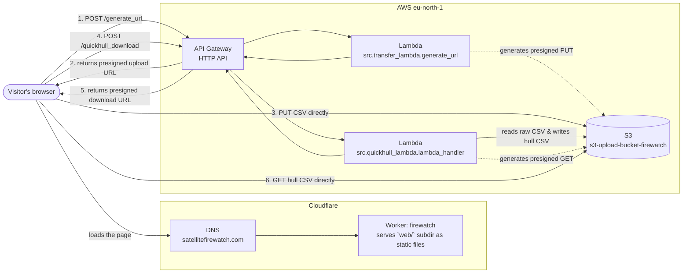
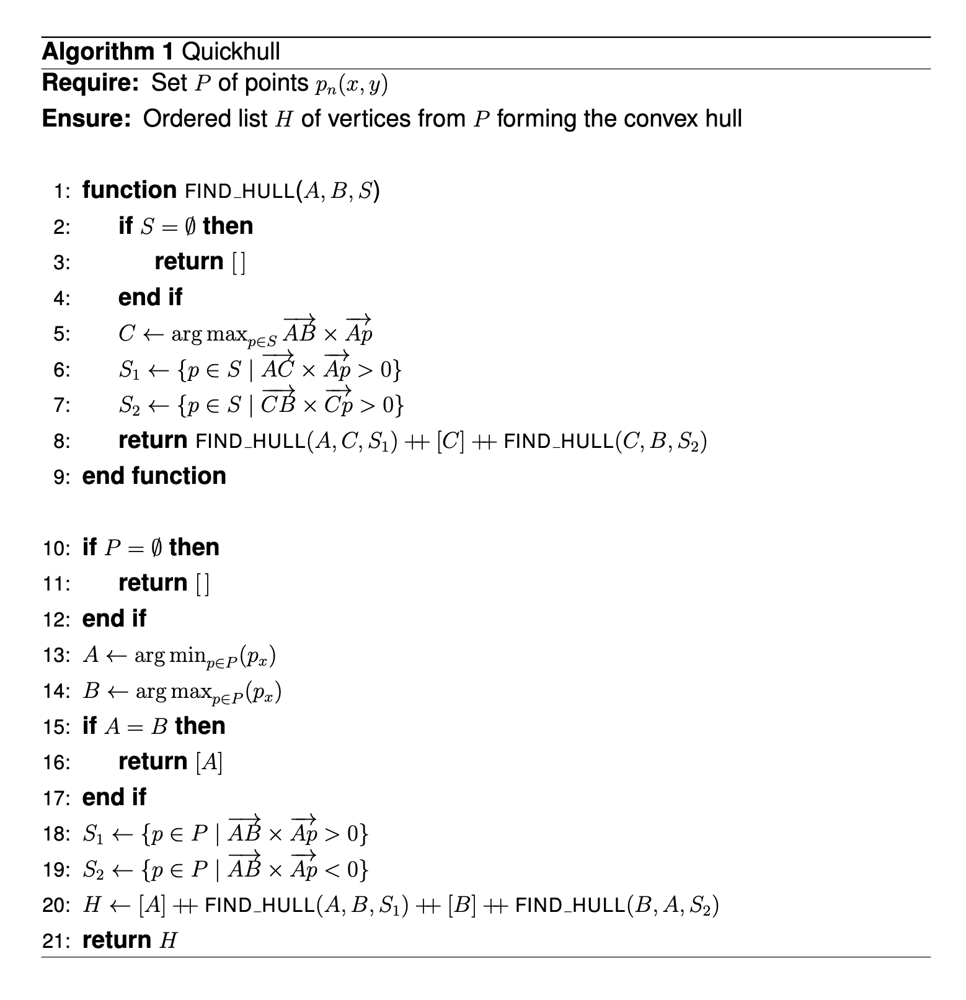

# ECM3428 Group Project Submission

|                        |                                                                                                                                          |
| ---------------------- | ---------------------------------------------------------------------------------------------------------------------------------------- |
| **Project title**      | Satellite Fire Watch                                                                                                                     |
| **Selected algorithm** | Quickhull                                                                                                                                |
| **Problem statement**  | Given a set of raw coordinate data from fire monitoring satellites, identify the convex hull (which represents the surface area at risk) |
| **Intended users**     | Fire departments in affected areas, wildfire researchers                                                                                 |

---

## Table of contents
- [Deployed URL](#url)
- [Install](#install)
- [Testing](#testing)
  - [macOS / Linux](#macos--linux)
  - [Windows PowerShell](#windows-powershell)
- [Pseudocode](#pseudocode)
- [Time and space complexity](#time-and-space-complexity)
- [Dependencies and third-party resources](#dependencies-and-third-party-resources)
- [Test Cases](#test-cases)
  - [Framework for testing](#framework-for-testing)
  - [Hull Input](#hull-input)
  - [Hull Examples](#hull-examples)
  - [Hull Properties](#hull-properties)
  - [Parser](#parser)
  - [Benchmarking tests](#benchmarking-tests)
  - [Results](#results)
- [Limitations](#limitations)
- [Individual Contributions](#individual-contributions)
- [Acknowledgment of generative AI use](#acknowledgment-of-generative-ai-use)


## Deployed URL

The website is live at
[satellitefirewatch.com](https://satellitefirewatch.com).

## Install

- The website is hosted on AWS, using S3 for file storage and Lambdas for
  serverless compute.
- For running locally, the only requirement is a Python runtime (3.12+).
- Try it out locally using:

  ```sh
  python3 -m venv venv
  source venv/bin/activate # (or ./venv/Scripts/Activate.ps1 on Windows)
  pip install -r requirements.txt
  cd web
  python3 -m http.server
  ```

  And then visit <http://localhost:8000>.



## Testing

Install the development dependencies, then run our Python test suite using

### macOS / Linux

```sh
python3 -m venv venv
source venv/bin/activate
pip install -r requirements-dev.txt
python3 -m unittest
```

### Windows PowerShell

```sh
python -m venv venv
.venv/bin/Scripts/Activate.ps1
pip install -r requirements-dev.txt
python -m unittest
```

We have a mix of white-box and black-box testing.

## Pseudocode



## Time and space complexity

| **Time complexity** |               |
| ------------------- | ------------: |
| Average             | $O(n log(n))$ |
| Worst case          |      $O(n^2)$ |

On average, the time complexity of the Quickhull algorithm is $O(n \: log(n))$,
with $n$ being the number of points. However, certain configurations of inputs
can lead to a worst case time complexity of $O(n^2)$, due to recursion (in the
divide and conquer strategy) not creating an efficient partitioning of work
(unbalanced partitions cause every "division" to be a partitioning of the work
into two **unequal** parts).

| **Space complexity** |        |
| -------------------- | -----: |
| All cases            | $O(n)$ |

For all input configurations, the space complexity of the Quickhull algorithm
is $O(n)$.

Sources:

> [The Quickhull Algorithm for Convex Hulls. Barber, C. Bradford; Dobkin, David P.; Huhdanpaa, Hannu. In: ACM Transactions on Mathematical Software, Vol. 22, No. 4, 12.1996, p. 469-483.](https://collaborate.princeton.edu/en/publications/the-quickhull-algorithm-for-convex-hulls/)

<!-- -->

> [Algorithmic Efficiency in Convex Hull Computation: Insights from 2D and 3D Implementations. Hyun Kwon, Sehong Oh and Jang-Woon Baek, Symmetry 2024](https://www.mdpi.com/2073-8994/16/12/1590)

<!-- -->

> [A Proof for a QuickHull Algorithm. Greenfield, Jonathan Scott, 1990](https://surface.syr.edu/record/5915?v=pdf)

## Dependencies and third-party resources

|                           |                                                                                                                                                                                                                                                                                                                                                                                                                      |
| ------------------------- | -------------------------------------------------------------------------------------------------------------------------------------------------------------------------------------------------------------------------------------------------------------------------------------------------------------------------------------------------------------------------------------------------------------------- |
| **Third-party resources** | The initial datasets for historic fire locations were taken from NASA's FIRMS (Fire Information for Resource Management System) dataset, freely available [here](https://firms.modaps.eosdis.nasa.gov/active_fire). <br>Settlement data is gathered from the Natural Earth Populated Places dataset, freely available [here](https://www.naturalearthdata.com/downloads/10m-cultural-vectors/10m-populated-places/). |
| **Dependencies**          | Python 3.12+ for runtime. <br>Amazon AWS S3 and Lambdas for file storage and compute (and AWS SDK for deployment). <br>Cloudflare for DNS and edge hosting.                                                                                                                                                                                                                                                          |

## Test Cases

### Framework for testing

All tests used Python's "unittest" library, which is the built-in Python
testing library.

We implement a `HullTestCase` class which contains methods used to verify the
properties of each hull we test. These checks are applied via the methods
`assert_is_convex_hull_of` and `assert_same_cycle`.

`assert_is_convex_hull_of` verifies that, for a set of points:

1. Output must be a subset of the input.
2. No point in the output should appear more than once.
3. Every consecutive 3-tuple of points in the output turns the same way.
4. Every single point from the input is either inside the hull, or part of the
   hull border.

`assert_same_cycle` verifies that, for a list of points in a hull, the points
are ordered in the expected cyclic order.

A `setup.py` file is also used to initialise additional files required before
the test suite begins and remove them following its conclusion. The files in
question are `large.csv`, a file too large to be stored permanently, and
`random.csv`, which contains data which is randomised in-between runs.

### `HullInput` and `Point`

We test that the `HullInput` and `Point` classes accept valid inputs and reject
invalid inputs to ensure that hulls can only be created using valid inputs.

- `Point` class accepts a mix of integers, floats, positive, and negative
  values for input.
- `Point` class rejects non-numeric inputs - these include strings, Booleans,
  arrays, and null values with `TypeError`.
- `Point` class rejects nan and infinite values with `ValueError`
- `Point` class only accepts two arguments for input, and for any other amount
  throws `TypeError`
- `HullInput` requires at least two unique points and throws `ValueError` if
  less are given - we test with one `Point`, zero Points, and multiple repeats
  of the same `Point`.
- `HullInput` accepts cases with two or more unique points - we test boundary
  cases with two points and three points with one duplicate, as well as real
  sample data with more than two points.

### Convex hulls

We test that our quickhull algorithm produces the expected outcome on a variety
of hand-picked point sets:

- A valid, real data mixed set of points including positive, negative, integer,
  and float values.
- For a hull with multiple points tied as farthest from a line, the hull will
  exclude non-corner points along the hull edge,regardless of input order.
- A convex hull will be created from only two distinct input points
- A convex hull will be created from two distinct input points and multiple
  duplicates.
- A convex hull will be created from only three distinct points.
- A convex hull will be created from a set of horizontally collinear points.
- A convex hull will be created from a set of diagonally collinear points.
- A convex hull will be created from a set of vertically collinear points.
- A convex hull will be created from a set of floating points values

### Hull properties

Metamorphic tests are implemented to verify that input alterations change or do
not change the output as expected. We apply changes to a valid, real data mixed
set of points including positive, negative, integer, and float values:

- Appending an additional boundary point to the set of points will result in a
  hull including that additional hull
- Appending an additional interior point to the set of points will result in
  the same hull.
- Moving a point to the boundary of a hull changes the hull cycle order and the
  moved point is a part of the hull.
- Moving a hull boundary point to a different position on the hull boundary
  maintains the hull order and includes moved point.
- Removing a boundary point from the set of points doesn’t affect hull order
- Removing an interior point from the set of points doesn’t affect hull order
  or elements
- Translating the points in the graph does not affect the hull order or
  elements; translation cases include adding/subtracting from x and y;
  adding/subtracting x or y alone.
- Reflecting a hull’s co-ordinates does not alter the order of the subsequent
  hull cycle. Reflection is performed in the x and y axes alone, as well as
  both simultaneously.
- Scaling a hull’s co-ordinates does not alter the order of the subsequent hull
  cycle. Cases includes multiplying/dividing x and y; multiplying/dividing x or
  y alone.
- Rotating a hull’s co-ordinates does not alter the order of the subsequent
  hull cycle. Cases include rotating x and y clockwise/counterclockwise;
  rotating x or y alone clockwise/counterclockwise.
- Re-ordering the input list of points does not affect the subsequent hull
  cycle ordering.

### Parser

We test that the parser rejects invalid CSV formats and outputs a dictionary of
the expected length for valid inputs; this includes inputs with out-of-bounds
lines, which should be ignored for the dictionary output.

Valid cases:

- An empty CSV file
- A CSV with two points
- A CSV with valid latitude and longitude, but missing dates
- A CSV with an average number of valid lines
- A bigger CSV with an average number of valid lines
- A CSV with a single point
- A CSV with one empty line partway through
- A CSV with three points
- A large csv (roughly 10MB)
- A CSV containing random, in-bounds data

Invalid Cases:

- A CSV populated with non-numeric values
- A CSV with a date field using an incorrect format (not dd/mm/yyyy)
- A CSV with an invalid date
- A CSV with a boundary invalid date; a leap day on a non-leap year
- A CSV missing its longitude field
- A CSV where one element misses longitude
- A CSV with lines missing commas
- A file with the wrong file type - zip file not CSV.

Out-Of-Bounds Cases:

- A CSV with dates in the future and before satellite data was made available
- A CSV with latitude < -90
- A CSV with longitude > 180 and longitude < -180
- A CSV with multiple out-of-bounds fields in different lines
- A CSV where all lines contain out-of-bounds data; effectively empty.

### Benchmarking tests

We verify that our algorithm is able to produce a valid convex hull for an
extremely large number of points (600,000).

We compare the time performance of our quickhull algorithm to the standard
scipy implementation using a custom function defined in `benchmark_timing.py`:

- Average input size of 100 points
- Average input size of 100 random points
- Large input size of 10,000 points

### Results

All tests pass; time performance is marginally superior to scipy variant -
execution time for average input size for both quickhull implementations is
~0.00004s, however for the larger input size case, ours clocks at ~0.002s
whereas scipy takes ~0.004s.

## Limitations

While we are happy with the level of polish we were able to implement within
the allotted timeframe, this version of our product nevertheless presents some
limitations:

- The settlements dataset is not as comprehensive as we would have hoped for.
  This would be a natural area for future development.
- Live API integration is another stretch goal for future development.

## Individual Contributions

- **Emre Acarsoy**:
  - Implemented the Quickhull algorithm in Python.
  - Wrote the pseudocode for the algorithm.
  - Wrote time and space complexity analysis for Quickhull.
  - Created custom data-structures for integrated data validation.
  - Implemented logic for drawing points onto the map.
  - Contributed to test suite.
  - Created the sidebar interface on the web UI.
  - Added Cloudflare edge hosting deployment and DNS setup.
  - Set up automatic linting and formatting for the repository.
  - Set up CI automations, including automatically running linting, formatting,
    and test running using GitHub Actions.
  - Set up repository rules for engineering best practices (branch protections,
    custom CONTRIBUTING.md style guide).

- **Luca Croci**:
  - Led the visual design of the website.
  - Created a landing page.
  - Implemented UX improvements, including waiting indicators.

- **Luca Pacitti**:
  - Implemented foundational testing framework, including setup and teardown
    logic.
  - Wrote metamorphic, large input, and random input tests
  - Fixed bugs in algorithm validation.

- **Harry Taylor**:
  - Designed, implemented, and automated the deployment on AWS.
  - Designed compute architecture, including server-side storage using S3.
  - Wrote AWS Lambda functions in Python (for upload, download, and algorithm
    computation logic).
  - Implemented file upload feature in JavaScript.
  - Implemented settlement detection in JavaScript.
  - Added performance improvements to csv parsing, namely moving away from the
    pandas Python library to reduce memory usage.

- **Jack Wyatt**:
  - Implemented foundational testing framework, including setup and teardown
    logic.
  - Wrote a comprehensive suite of white-box and black-box tests.
  - Wrote large input and random input tests.
  - Fixed bugs on the core algorithm.
  - Added input data validation (real coordinate validation etc...).

## Acknowledgment of generative AI use

Generative AI was used in this AI-assisted coursework. AI-generated output was
not accepted uncritically, and our group remains responsible for the
correctness, security, quality, and originality of everything submitted.

- Tools: Claude and OpenAI large language models
- Representative prompts:

> Draft a mermaid diagram of this structure

<!-- -->

> Give me boilerplate for adding a button which links to the /animations
> subdirectory

<!-- -->

> Give these css elements the same dark blue colours

<!-- -->

> How do you do the official algorithm style in latex?

<!-- -->

> Why doesn't git fetch origin --prune auto delete the branches that I have
> locally that have been merged and then deleted in remote?

<!-- -->

> How can I optimise aws lambdas?

<!-- -->

> How can I overlay a map of various areas of quickhull over an openstreetmap?

<!-- -->

> How can I roll back a number of commits in a branch?

<!-- -->

> How can I safely clean my branch's Git history so that it contains only the
> commits directly to that branch?

<!-- -->

- How its output was checked: All generative AI output was checked manually by
  our team, and as the coursework requires, no output was uncritically
  accepted. The group remained responsible for correctness, security, etc
  throughout the project.
